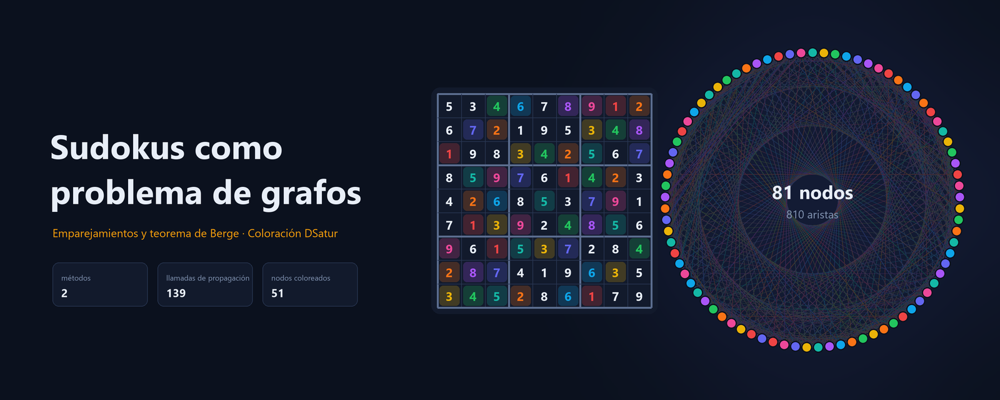
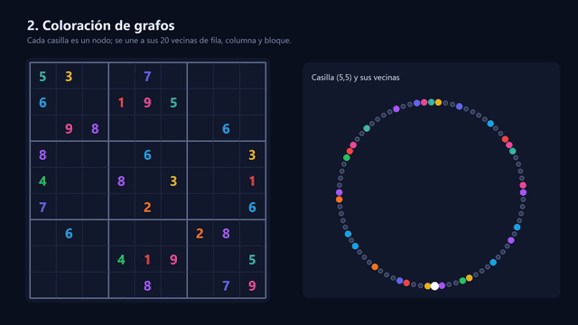
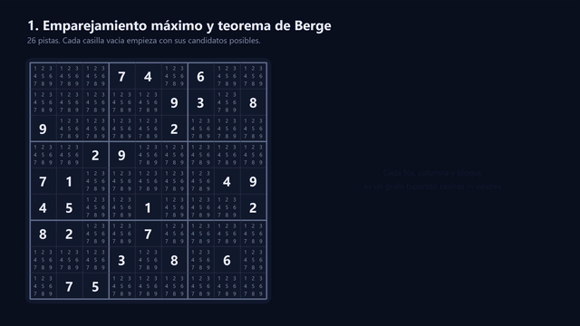
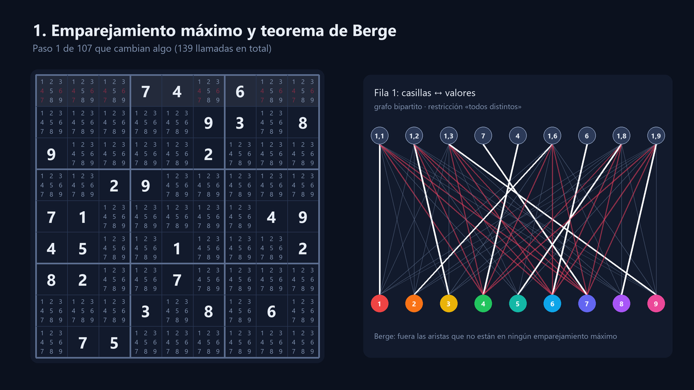
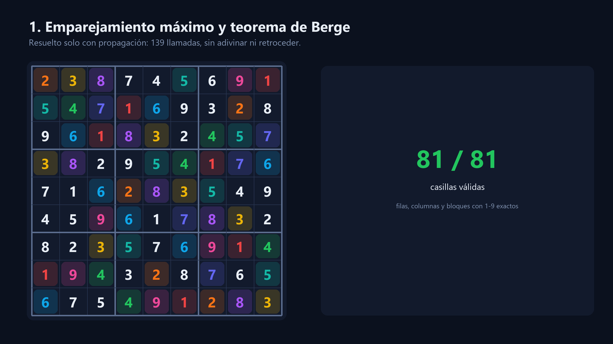
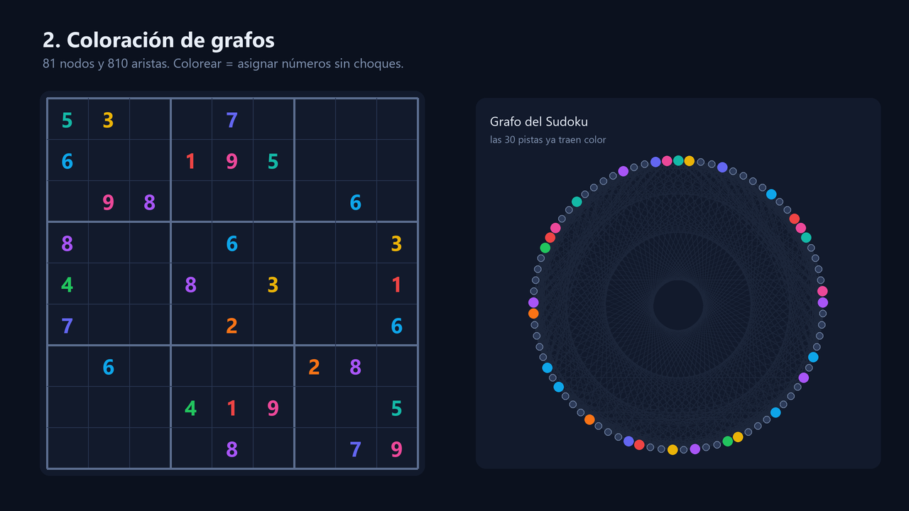
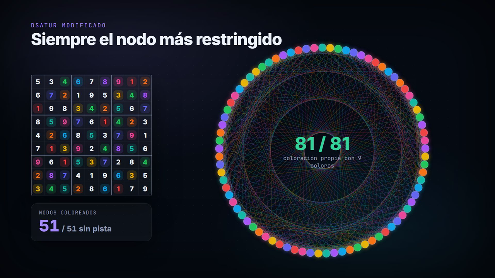

# Resolución de Sudokus mediante teoría de grafos

<p align="center"></p>

<p align="center">
  
  
  
  
  
</p>

<p align="center"></p>

<p align="center">
  <a href="docs/sudoku_grafos.mp4"><b>▶ Ver el video completo (62 s)</b></a> ·
  <a href="G04.pdf">Informe (PDF)</a> ·
  <a href="G04-poster.pdf">Póster</a> ·
  <a href="G04-presentación.pdf">Presentación</a>
</p>

Un Sudoku es un problema de grafos disfrazado. Este proyecto lo resuelve de **dos formas distintas** y compara
los resultados:

| | Emparejamiento + teorema de Berge | Coloración de grafos (DSatur) |
|---|---|---|
| **Modelo** | Cada fila, columna y bloque es un grafo bipartito casillas ↔ valores | El tablero entero es un grafo de 81 nodos y 810 aristas |
| **Idea** | Un valor solo es posible si la arista está en algún emparejamiento máximo | Colorear sin que dos vecinos compartan color es llenar el Sudoku |
| **Búsqueda** | Ninguna: propagación de restricciones hasta un punto fijo | Voraz: elige siempre el nodo más restringido |
| **En la animación** | `sudoku_3.txt`, 26 pistas, resuelto en 139 llamadas | Sudoku clásico de 30 pistas, 51 nodos coloreados |

Las animaciones no son una recreación: se generan **ejecutando el código de este repositorio** y registrando cada
paso desde fuera, sin tocar los algoritmos (ver [`docs/animacion/generar.py`](docs/animacion/generar.py)). Al final,
el script verifica que las dos soluciones sean válidas.

---

## 1. Emparejamiento máximo y teorema de Berge

<p align="center"></p>

Cada unidad del tablero (9 filas, 9 columnas y 9 bloques) impone la restricción **«todos distintos»**. Para cada
una se construye un grafo bipartito: arriba las 9 casillas, abajo los valores del 1 al 9, y una arista por cada
candidato posible.

<p align="center"></p>

Para cada unidad, el algoritmo de `main (1).py`:

1. **Encuentra un emparejamiento máximo** entre casillas y valores (`networkx`, Hopcroft-Karp). Si no cubre todas
   las casillas, el Sudoku no tiene solución (`InfeasibleError`).
2. **Orienta el grafo**: las aristas del emparejamiento van de casilla a valor y el resto, de valor a casilla.
3. **Aplica el teorema de Berge**: una arista pertenece a algún emparejamiento máximo solo si está en el
   emparejamiento o en un ciclo alternante. Los ciclos alternantes son las **componentes fuertemente conexas** del
   grafo orientado.
4. **Elimina** los candidatos cuyas aristas no cumplen eso (en rojo en la animación) y avisa a las unidades
   afectadas, que se vuelven a revisar. El proceso se repite hasta que nada cambia.

Con `sudoku_3.txt` (26 pistas), el tablero queda resuelto **solo con propagación**: 139 llamadas, de las cuales 107
eliminan algún candidato, sin adivinar ni retroceder.

<p align="center"></p>

---

## 2. Coloración de grafos con DSatur

Cada casilla es un **nodo** y se une con sus **20 vecinas** (8 de su fila, 8 de su columna y 4 más de su bloque).
Eso da 81 nodos y 81 × 20 / 2 = **810 aristas**. Cada número del 1 al 9 es un color, y resolver el Sudoku equivale
a encontrar una coloración propia con 9 colores que respete las pistas.

<p align="center"></p>

La implementación de `Coloracion/` es un **DSatur modificado**:

- `S2G` convierte el Sudoku en el grafo (`Graph.py`), con las pistas ya coloreadas.
- `chrom` mide la **saturación** de un nodo: cuántos colores distintos tienen sus vecinos.
- `coloring` elige en cada paso el nodo sin color con mayor saturación y le asigna el primer color que no usan sus
  vecinos.
- `G2S` devuelve el grafo coloreado a forma de Sudoku.

<p align="center"></p>

La coloración es más sencilla de implementar, pero es voraz y no retrocede: en Sudokus difíciles puede quedarse sin
colores válidos. En el informe, para tableros de 9×9 hizo falta partir de unas 30 pistas.

---

## Resultados

| Método | Sudoku | Pistas | Trabajo | Tiempo medido |
|---|---|---|---|---|
| Emparejamiento + Berge | `sudoku_3.txt` | 26 | 139 llamadas de propagación | 0,03 s |
| Coloración DSatur | Clásico 9×9 | 30 | 51 nodos coloreados | 0,11 s (130 ms en el informe) |
| Coloración DSatur | 4×4 | 4 | 12 nodos | 1,16 ms (informe) |

Los tiempos dependen del equipo; los de esta tabla salen de una ejecución en un portátil con Python 3.

## Cómo ejecutarlo

```bash
pip install networkx numpy

# Emparejamiento + teorema de Berge
python "main (1).py" sudoku_3.txt

# Coloración de grafos (resuelve el Sudoku de ejemplo de Functions.py)
cd Coloracion
python Functions.py
```

Formato de `sudoku_3.txt`: 9 líneas de 9 números separados por espacios, con `0` en las casillas vacías.

Para regenerar el video, los GIF y las imágenes:

```bash
pip install networkx numpy pillow imageio-ffmpeg
python docs/animacion/generar.py
```

## Estructura

```
main (1).py              emparejamiento máximo + teorema de Berge (propagación de restricciones)
sudoku_3.txt             Sudoku de prueba (26 pistas)
Coloracion/
  Graph.py               grafo simple: nodos, aristas y vecinos
  Sudoku.py              tablero n² × n² y verificación
  Functions.py           Sudoku → grafo, DSatur modificado, grafo → Sudoku
docs/                    video, GIF e imágenes del README
  animacion/generar.py   genera todo lo anterior a partir de la ejecución real
G04.pdf                  informe
G04-poster.pdf           póster
G04-presentación.pdf     presentación
```

## Autores

**Gabriel S. Fandiño H. · Carlos A. Galán P. · Rosa A. Galicia J.**
Escuela de Ingeniería, Ciencia y Tecnología, Universidad del Rosario.
